# Missione Odessa - Rapporto tecnico as-built v1.3.4

**Stato:** verificato sul repository  
**Data di verifica:** 24 settembre 2026  
**Versione applicativa:** 1.3.4  
**Baseline funzionale:** commit `0477ad17595e832ab1184d1235bd5d3a35f09cc3`  
**Repository:** `Aqualung61/MissioneOdessa`  
**Scopo:** documentare con accuratezza l'implementazione corrente di Missione Odessa. Questo documento non e' una specifica per un nuovo motore e non propone una reingegnerizzazione.

**Revisione 2026-10-14 (#92):** corretti §11.5 (teleport finale) e Figura 7 (§9, prerequisiti non soddisfatti). Il documento resta la fotografia della v1.3.4: dalla v1.4.0 (#91) il motore per sessione è creato con `createEngine()` e non più con istanze di modulo ESM, quindi §12 e §21.2 descrivono il comportamento della sola v1.3.4.

## 1. Metodo, perimetro e autorita' delle fonti

Il rapporto aggiorna e completa il PDF CodeWiki generato sul commit `0477ad1`. Le affermazioni sono state verificate contro codice, dati JSON, test e configurazione della versione 1.3.4. I documenti storici sono stati usati solo per contesto e non prevalgono sul comportamento osservabile.

Ordine delle fonti usato nella verifica:

1. codice e configurazione della v1.3.4;
2. test Vitest correnti;
3. dati sotto `src/data-internal/`;
4. documentazione architetturale corrente, con la nota multi-sessione del 15 gennaio 2026;
5. PDF CodeWiki come indice e rappresentazione secondaria.

Il checkout verificato era sul commit `efeb0ab9357093782f28b4044a6fc3e27a7df292`; `origin/main` era `0a2d6842c77bb3f41c52a6f5a68bcdd02d95a7ab`. Il confronto degli alberi non mostrava differenze applicative: i commit successivi alla baseline CodeWiki riguardavano istruzioni operative e l'esclusione del workspace di disassembly.

## 2. Sintesi del sistema

Missione Odessa e' una text adventure web con:

- backend Node.js ed Express 5;
- frontend statico HTML, CSS e JavaScript;
- parser lessicale server-side;
- motore di gioco stateful e data-driven;
- dati statici JSON caricati in memoria;
- una partita isolata per tab/sessione, senza cookie;
- interfacce e contenuti in italiano e inglese;
- salvataggi JSON gestiti dal client;
- test unitari, di integrazione e di contratto API con Vitest.

**Figura 1 - Architettura complessiva.**

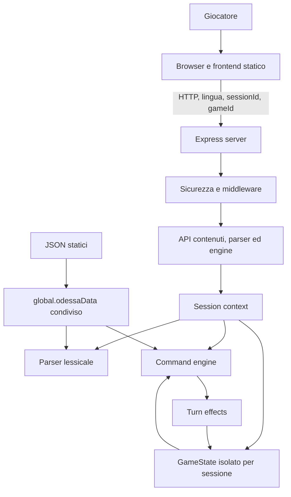

## 3. Struttura del repository

| Area                     | Responsabilita'                                                       |
| ------------------------ | --------------------------------------------------------------------- |
| `src/server.js`          | bootstrap Express, sicurezza, mount API, statico e 404                |
| `src/api/`               | route contenuti, lingua, parser, engine e configurazione              |
| `src/logic/parser.js`    | lessico, normalizzazione, grammatica e ParseResult                    |
| `src/logic/engine.js`    | GameState, comandi, interazioni, punteggio e snapshot                 |
| `src/logic/turnEffects/` | effetti temporali post-comando                                        |
| `src/middleware/`        | auth, sessioni, validazione, rate limit ed errori                     |
| `src/data-internal/`     | dati statici e contenuti localizzati                                  |
| `web/`                   | pagine e client browser                                               |
| `tests/`                 | suite Vitest primaria                                                 |
| `types/`                 | dichiarazioni TypeScript di supporto, non schema completo del runtime |

## 4. Bootstrap e ciclo di vita del server

`src/server.js` esegue la seguente sequenza:

1. carica le variabili ambiente tramite `dotenv/config`;
2. crea l'app Express e configura opzionalmente `trust proxy`;
3. applica Helmet con Content Security Policy;
4. legge `PORT` e `BASE_PATH`;
5. carica i JSON con `initOdessa()` in `global.odessaData`;
6. salva una copia degli oggetti originali, inizializza lo stato e carica i messaggi di sistema;
7. registra versione e configurazione pubbliche;
8. applica CORS opzionale, parser JSON, auth e rate limiting;
9. monta le API prima dello statico;
10. serve il repository come static root e `web/404.html` per le risorse mancanti;
11. installa l'error handler globale e avvia l'ascolto.

`BASE_PATH` consente il deploy in sottocartella. `GET /api/config` resta sempre disponibile alla radice; quando `BASE_PATH` e' valorizzato viene esposta anche la variante sotto quel prefisso. Il payload restituisce un base path normalizzato con slash finale e l'elenco delle lingue.

Nota operativa: `initOdessa()` cattura gli errori dei singoli file e prosegue. Di conseguenza il `try/catch` esterno in `server.js` intercetta solo errori propagati, non garantisce da solo che ogni tabella sia stata caricata. La coerenza dei dataset e' quindi affidata anche ai test.

**Figura 2 - Bootstrap e ordine dei layer Express.**

```mermaid
%% PDF_DIAGRAM:bootstrap
flowchart LR
  Start[Avvio Node] --> Env[Env e trust proxy]
  Env --> Helmet[Helmet e CSP]
  Helmet --> Init[Caricamento JSON e stato]
  Init --> Public[Versione e config pubbliche]
  Public --> Boundary[CORS e JSON body]
  Boundary --> Auth[API key]
  Auth --> Limits[Rate limiting]
  Limits --> Api[API routes]
  Api --> Static[File statici e 404]
  Static --> Errors[Error handler]
  Errors --> Listen[app.listen]
```

## 5. Data layer

### 5.1 Caricamento e condivisione

I file `src/data-internal/*.json` sono caricati sincronicamente all'avvio e raccolti in `global.odessaData`. Non esiste un database runtime.

Tabelle caricate:

`Interazioni`, `Introduzione`, `Storia`, `LessicoSoftware`, `Lingue`, `Luoghi`, `LuoghiLogici`, `MessaggiFrontend`, `MessaggiSistema`, `Oggetti`, `Piattaforme`, `Software`, `TerminiLessico`, `TipiLessico`, `VociLessico`.

Conteggi rilevati sui dataset centrali:

| Dataset                | Record | Significato                  |
| ---------------------- | -----: | ---------------------------- |
| `Luoghi.json`          |    118 | 59 luoghi x 2 lingue         |
| `Oggetti.json`         |     76 | 38 oggetti x 2 lingue        |
| `Interazioni.json`     |     38 | 19 interazioni x 2 lingue    |
| `TerminiLessico.json`  |     70 | concetti lessicali           |
| `VociLessico.json`     |    214 | forme e sinonimi localizzati |
| `MessaggiSistema.json` |    120 | messaggi localizzati         |

### 5.2 Dati condivisi e dati di partita

La separazione prevista e':

- `global.odessaData`: definizioni condivise, trattate come dati statici;
- `gameState.Oggetti`: copia profonda degli oggetti della lingua della partita;
- `gameState`: stato mutabile della singola partita.

`initializeOriginalData()` conserva la copia sorgente degli oggetti in `globalThis.__odessaOriginalOggetti`; ogni reset crea una nuova copia per la lingua scelta.

**Figura 3 - Separazione tra definizioni condivise e stato di partita.**

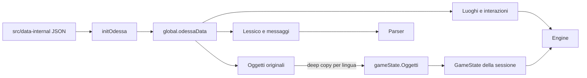

### 5.3 Invarianti dati principali

- I record localizzati condividono lo stesso ID concettuale e differiscono per `IDLingua`.
- L'inventario e' rappresentato da `IDLuogo === 0`.
- `Attivo >= 1` rende un oggetto visibile; `Attivo >= 3` lo rende raccoglibile.
- Una direzione con destinazione inferiore a 1 e' bloccata.
- `Terminale === -1` identifica un luogo terminale.
- Le route e il motore devono filtrare i record per la lingua della partita.

## 6. Stato di gioco

`gameState` e' una variabile di modulo in `src/logic/engine.js`. All'interno di una singola istanza dell'engine costituisce la fonte di verita' della partita.

Struttura effettiva, piu' ampia delle dichiarazioni in `types/game-state.d.ts`:

**Figura 4 - Componenti del GameState e ciclo di persistenza.**

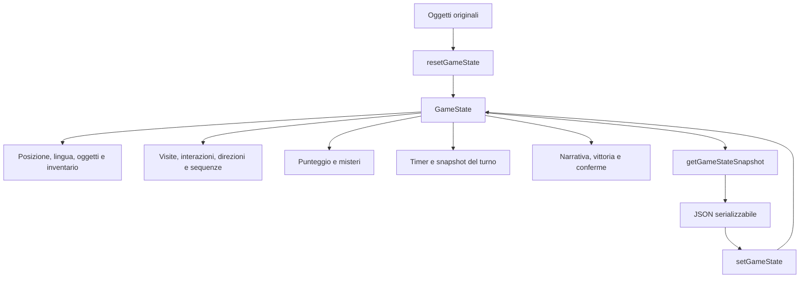

`resetGameState(idLingua)` ricostruisce completamente lo stato. `getGameStateSnapshot()` converte i `Set` in array, elimina il `parseResult` corrente e aggiunge nome luogo, timestamp e versione. `setGameState()` ricostruisce `Set`, oggetti e struttura del turno con fallback compatibili con salvataggi precedenti.

## 7. Parser

Il parser usa il lessico in memoria e mantiene una cache separata per lingua.

### 7.1 Normalizzazione

- accetta solo stringhe;
- rifiuta input vuoto, oltre 500 caratteri o con caratteri ASCII di controllo;
- sostituisce la punteggiatura comune con spazi, preservando `?`;
- rimuove i diacritici;
- converte in maiuscolo e compatta gli spazi;
- elimina le stopword definite nel lessico.

### 7.2 Categorie

Il lessico distingue `ACTION`, `NAVIGATION`, `SYSTEM`, `NOUN` e `STOPWORD`. Un comando valido prodotto dal parser appartiene normalmente a una delle prime tre categorie.

### 7.3 Grammatica implementata

- un token: navigazione, sistema o alcune azioni senza oggetto;
- due token: azione piu' sostantivo;
- tre token: azione, sostantivo e indice numerico, oppure azione piu' sostantivo composto di due parole;
- piu' token utili: struttura non valida.

Le azioni senza oggetto ammesse esplicitamente sono `DORMI`, `ESAMINA` e `GUARDA` nelle rispettive forme canoniche.

### 7.4 Error taxonomy

`INVALID_INPUT`, `COMMAND_UNKNOWN`, `SYNTAX_ACTION_INCOMPLETE`, `SYNTAX_NOUN_UNKNOWN`, `SYNTAX_INVALID_STRUCTURE`.

Il parser non deve lanciare eccezioni per input utente invalido: restituisce un `ParseResult` deterministico con campi diagnostici. L'endpoint target `/api/engine/execute` traduce gli errori sintattici in messaggi localizzati e risponde HTTP 200 con `ok:false`; le violazioni della validazione HTTP rispondono 400.

**Figura 5 - Dal testo al comando canonico.**

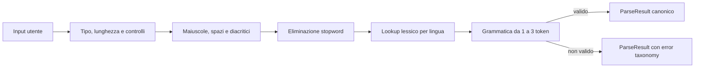

## 8. Pipeline del motore

Il flusso target parte da `POST /api/engine/execute`:

**Figura 6 - Pipeline di `POST /api/engine/execute`.**

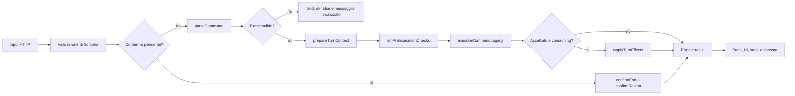

`executeCommandAsync()` e' un wrapper sincrono esposto come funzione asincrona. Il core dei comandi risiede ancora in `executeCommandLegacy()`, nome che indica l'origine del blocco ma non un endpoint legacy.

### 8.1 Consumo del turno

- comandi `SYSTEM`: non consumano tempo;
- `NAVIGATION` e `ACTION`: consumano tempo se validi;
- parse result invalido o nullo: non consuma tempo;
- `globalTurnNumber` aumenta per ogni comando preparato;
- `totalTurnsConsumed` aumenta solo per i comandi consuming.

### 8.2 Navigazione

Le direzioni canoniche sono mappate sui campi `Nord`, `Est`, `Sud`, `Ovest`, `Su`, `Giu`. `getDirezioniLuogo()` combina la mappa statica del luogo con sblocchi e toggle presenti nello stato. Una navigazione valida usa `setCurrentLocation()`, registra la prima visita e assegna un punto solo se il luogo esiste e non e' terminale.

### 8.3 Comandi di sistema

Sono gestiti almeno: inventario, aiuto, salva, carica, punti e fine. I comandi di salvataggio e caricamento restituiscono result type dedicati, poi il client esegue le chiamate API specifiche. `FINE` attiva una conferma SI/NO gestita prima del parser nelle richieste successive.

### 8.4 Azioni standard

Il motore gestisce direttamente:

- esamina/guarda luogo o oggetto;
- apri/chiudi gli elementi presenti in `openStates`;
- prendi oggetti raccoglibili, con inventario massimo di cinque elementi;
- posa/lascia un oggetto dell'inventario;
- messaggi localizzati per oggetto assente o azione non supportata.

Prima degli handler standard vengono cercate le interazioni dichiarative.

## 9. Interazioni dichiarative

Ogni record di `Interazioni.json` contiene:

- `id` e `IDLingua`;
- `trigger.verbo` e `trigger.oggetto`;
- `condizioni.luogo` e `condizioni.prerequisiti`;
- `risposta` ed eventuali risposte alternative;
- `effetti[]`;
- flag `ripetibile`.

### 9.1 Prerequisiti presenti nei dati

| Tipo                    | Comportamento implementato                                                 |
| ----------------------- | -------------------------------------------------------------------------- |
| `OGGETTO_IN_INVENTARIO` | oggetto in luogo 0 e raccoglibile                                          |
| `OGGETTO_IN_LUOGO`      | oggetto visibile nel luogo richiesto                                       |
| `OGGETTO_VISIBILE`      | oggetto attivo nel luogo richiesto                                         |
| `SEQUENZA_COMPLETATA`   | sequenza presente e completata                                             |
| `INTERAZIONE_ESEGUITA`  | ID gia' registrato                                                         |
| `FLAG_FALSE`            | presente nei dati ma non interpretato esplicitamente dalla catena corrente |

Il comportamento per un tipo di prerequisito sconosciuto e' permissivo: non produce automaticamente un fallimento. Questo e' un limite documentale e implementativo da conoscere quando si modificano i dati.

### 9.2 Effetti presenti nei dati

| Tipo                | Effetto sullo stato                                      |
| ------------------- | -------------------------------------------------------- |
| `VISIBILITA`        | modifica `Attivo` dell'oggetto target                    |
| `SPOSTA_OGGETTO`    | cambia `IDLuogo`                                         |
| `SBLOCCA_DIREZIONE` | registra una destinazione permanente                     |
| `TOGGLE_DIREZIONE`  | apre o chiude dinamicamente un collegamento              |
| `SEQUENZA`          | delega la gestione speciale alla logica dell'interazione |
| `SET_FLAG`          | imposta una proprieta' annidata dello stato              |
| `RESET_COUNTER`     | porta a zero un contatore annidato                       |
| `VITTORIA`          | imposta `ended` e `victory`                              |

L'esecutore applica gli effetti in ordine. Per il punteggio del primo toggle aggiunge temporaneamente `_statoPreToggle` all'oggetto effetto proveniente dai dati condivisi. E' una mutazione circoscritta ma contrasta con l'intento di trattare `global.odessaData` come immutabile.

**Figura 7 - Risoluzione di una interazione dichiarativa.**

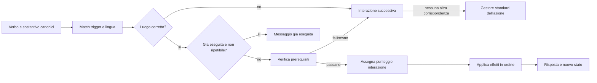

Nota: nella v1.3.4 un prerequisito non soddisfatto non produce un messaggio dedicato. L'interazione viene saltata (`continue`) e, se nessun'altra corrisponde, risponde il gestore standard dell'azione (per esempio "Non puoi accendere lampada."); i campi `risposta_no_*` presenti nei dati non sono usati. La correzione e' tracciata in #93.

## 10. Punteggio

Il punteggio viene mantenuto nello stato della partita:

- 1 punto iniziale per il luogo 1;
- +1 per la prima visita di un luogo non terminale;
- +2 per la prima esecuzione conteggiata di un'interazione;
- +3 per la prima risoluzione di determinati misteri prodotti da `VISIBILITA`, `SBLOCCA_DIREZIONE` e prima apertura di `TOGGLE_DIREZIONE`;
- +4 all'avvio della sequenza finale;
- +1 per la prima visita al luogo 59 durante il teleport finale.

I collegamenti bidirezionali usano una coppia ordinata di ID per evitare il doppio conteggio del mistero. Le soglie dei ranghi sono 34, 67, 100 e 134 punti. Il repository contiene commenti e test storici con calcoli teorici non perfettamente allineati; il presente rapporto non dichiara un punteggio massimo certificato.

## 11. Turn effects

L'ordine effettivo del registry e' vincolante:

1. `torchEffect`;
2. `darknessEffect`;
3. `gameOverEffect`;
4. `interceptEffect`;
5. `victoryEffect`.

Questa sequenza corregge una contraddizione del report CodeWiki: `gameOverEffect` viene eseguito prima dell'incremento di `interceptEffect`, non dopo.

**Figura 8 - Ordine effettivo dei turn effects.**

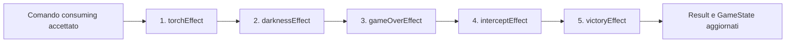

### 11.1 Luce e torcia

La torcia e' l'oggetto ID 37. Fornisce luce se e' nell'inventario e non e' difettosa. Diventa difettosa se non e' piu' nell'inventario oppure quando `totalTurnsConsumed >= 6`. La lampada e' l'oggetto ID 27 ed e' considerata accesa tramite `timers.lampadaAccesa`.

### 11.2 Buio

`darknessEffect` usa lo stato di luce corrente e precedente. La prima transizione da luce a buio concede un turno di grazia; i turni successivi incrementano `turnsInDarkness`. Il contatore viene azzerato quando torna la luce. `gameOverEffect` termina la partita a quota 3.

### 11.3 Intercettazione

Le zone pericolose codificate sono 51, 52, 53, 55, 56 e 58; il luogo 57 e' sicuro. `interceptEffect` incrementa il contatore solo per comandi consuming e lo resetta uscendo dalle zone. Poiche' il controllo game over precede l'incremento nel registry, la soglia di 4 viene osservata dal controllo successivo.

### 11.4 Altre condizioni di game over

`gameOverEffect` valuta in ordine:

- abbandono della lampada accesa senza torcia funzionante;
- morte dopo tre turni conteggiati al buio;
- ingresso in un luogo terminale;
- intercettazione;
- tre comandi inutili nella fase della guardia;
- limite opzionale `GAME_MAX_TURNS_CONSUMED`.

Quando scatta una condizione, imposta `awaitingRestart` e produce risultato e messaggio localizzati.

### 11.5 Sequenza di vittoria

La sequenza finale richiede luogo 1, luce e gli oggetti chiave ID 16, 6 e 34 nell'inventario. Quando le condizioni sono soddisfatte, nello stesso turno `victoryEffect` avvia la narrazione di Ferenc (+4 punti), rimuove i tre oggetti e teletrasporta al luogo 59 (+1 punto per la visita): imposta `awaitingContinue = false` e restituisce un result di tipo `TELEPORT`, senza alcuna attesa di continuazione. Qui il movimento e' bloccato e la fase narrativa attende l'interazione conclusiva con i documenti.

## 12. Sessioni e concorrenza

La definizione piu' accurata dello stato e': singleton di modulo per istanza engine, con una distinta istanza del modulo per sessione.

`attachEngineSession` gestisce:

- header request/response `X-Session-Id` e `X-Game-Id`;
- generazione self-healing di UUID quando assenti o invalidi;
- mappa in memoria `sessionId -> { gameId, engine, createdAt, lastAccessAt }`;
- massimo predefinito di 200 sessioni;
- TTL idle predefinito di 6 ore;
- TTL assoluto predefinito di 24 ore;
- eviction della sessione meno recentemente usata quando viene raggiunto il limite.

L'isolamento e' ottenuto importando `engine.js` con un query parameter univoco. Node crea cosi' un'istanza ESM distinta, ciascuna con il proprio `gameState`. La rimozione dalla mappa delle sessioni non elimina necessariamente il modulo dalla cache ESM: il limite alle sessioni attive e il TTL limitano lo store, ma non costituiscono una garanzia di rilascio della memoria dei moduli gia' importati.

Il reset mantiene il `sessionId` e genera un nuovo `gameId`. Il client salva entrambi in `sessionStorage`, ottenendo isolamento per tab senza cookie.

**Figura 9 - Isolamento per tab e ciclo della sessione.**

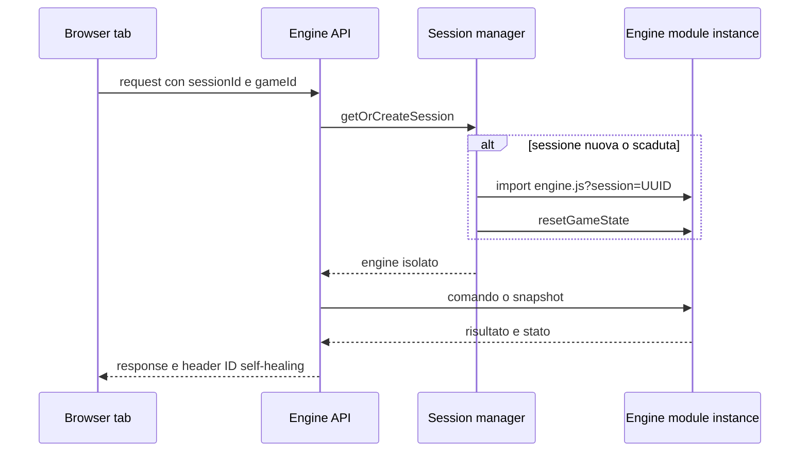

## 13. API HTTP

### 13.1 Endpoint pubblici registrati prima dell'auth

| Metodo | Endpoint                  | Risposta                              |
| ------ | ------------------------- | ------------------------------------- |
| GET    | `/api/version`            | versione applicativa                  |
| GET    | `/api/config`             | base path e lingue                    |
| GET    | `${BASE_PATH}/api/config` | stessa configurazione, se applicabile |

### 13.2 Contenuti e utilita'

| Metodo | Endpoint                         | Funzione                                  |
| ------ | -------------------------------- | ----------------------------------------- |
| GET    | `/api/frontend-messages/:lingua` | messaggi UI localizzati                   |
| GET    | `/api/introduzione`              | introduzione Markdown                     |
| GET    | `/api/storia`                    | contenuti e label della pagina storia     |
| GET    | `/api/luoghi`                    | luoghi arricchiti con immagine e buio     |
| GET    | `/api/luogo-oggetti`             | oggetti visibili della sessione nel luogo |
| GET    | `/api/ping`                      | health check minimale                     |
| GET    | `/api/lingue`                    | elenco lingue                             |

### 13.3 Parser

| Metodo | Endpoint             | Nota                                 |
| ------ | -------------------- | ------------------------------------ |
| POST   | `/api/parser/parse`  | legacy, deprecabile e disabilitabile |
| GET    | `/api/parser/stats`  | statistiche del lessico              |
| POST   | `/api/parser/reload` | invalida e precarica la cache        |

### 13.4 Engine

| Metodo | Endpoint                         | Funzione                                  |
| ------ | -------------------------------- | ----------------------------------------- |
| POST   | `/api/engine/execute`            | pipeline target input -> parser -> engine |
| GET    | `/api/engine/state`              | snapshot corrente                         |
| POST   | `/api/engine/reset`              | nuova partita e nuovo game ID             |
| POST   | `/api/engine/set-location`       | legacy, deprecato e disabilitabile        |
| POST   | `/api/engine/save-client-state`  | produce il file di salvataggio            |
| POST   | `/api/engine/load-client-state`  | valida e ripristina lo stato              |
| GET    | `/api/engine/direzioni/:idLuogo` | direzioni dinamiche senza consumare turno |
| GET    | `/api/engine/stats`              | statistiche e rango                       |

L'endpoint `/api/shutdown` esiste solo con `NODE_ENV=test`. La variabile `DISABLE_RUN_TESTS` e i riferimenti a `/api/run-tests` presenti in `.env.example` e in documenti storici non corrispondono a una route registrata nel server v1.3.4.

## 14. Contratto di `/api/engine/execute`

Una risposta riuscita contiene almeno:

- `ok:true`;
- `parseResult`;
- `command` normalizzato;
- `engine` con `accepted`, `resultType`, `message`, `turnMessages`, `gameOver`;
- `state` serializzato;
- `ui` con luogo e direzioni;
- `stats` con visite, interazioni, misteri, punteggio e rango.

Un errore del parser e' una risposta applicativa HTTP 200 con `ok:false`, `error`, `userMessage`, `engine:null` e `command:null`, mantenendo comunque `state`, `ui` e `stats`. Un input rifiutato dal middleware di frontiera produce HTTP 400. Gli stati di conferma bypassano il parser e restituiscono `parseResult:null` e `command:null`.

## 15. Salvataggio e caricamento

Il salvataggio contiene:

- snapshot `gameState`;
- `odessaData.Luoghi` forniti dal client per compatibilita';
- `odessaData.Oggetti` ricavati dallo stato server;
- timestamp e versione applicativa.

Il caricamento verifica che body, stato e dati siano oggetti semplici, limita a 500 luoghi e 5000 oggetti e rifiuta elementi primitivi nelle collezioni. La validazione resta intenzionalmente permissiva per supportare vecchi salvataggi.

Se il salvataggio e la sessione hanno codici lingua supportati diversi, la route risponde 409 `LANGUAGE_MISMATCH` e non modifica lo stato. `setGameState()` ripristina le strutture runtime e viene invalidata la cache lessicale condivisa.

**Figura 10 - Salvataggio e caricamento.**

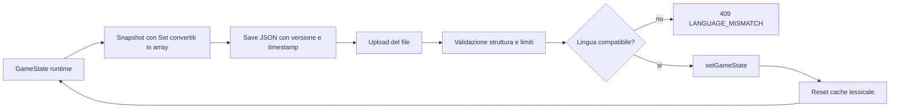

## 16. Frontend

Flusso pubblico:

**Figura 11 - Navigazione frontend e servizi utilizzati.**

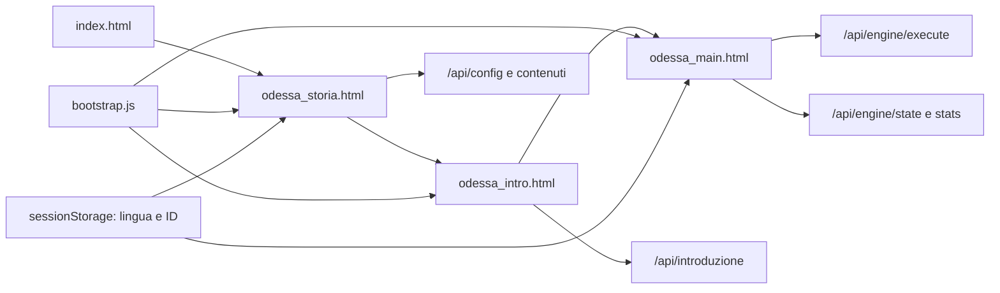

`bootstrap.js` calcola il base path, inizializza la lingua e pubblica helper in `window.odessa`. La lingua corrente e' memorizzata in `sessionStorage` con chiave `linguaSelezionata`; anche `odessa.sessionId` e `odessa.gameId` sono per-tab in `sessionStorage`.

Il client principale:

- aggiunge gli header di sessione a ogni richiesta stateful;
- aggiorna gli ID dalle response headers;
- invia input solo a `/api/engine/execute` nel flusso target;
- aggiorna output, luogo, immagine, direzioni e HUD dagli snapshot server;
- gestisce download e upload dei salvataggi;
- usa un meccanismo di sequenza delle richieste per evitare che risposte tardive sovrascrivano stato piu' recente.

I contenuti di introduzione e storia sono Markdown renderizzato tramite `marked.min.js`, con fallback a testo semplice. I messaggi UI sono applicati tramite attributi `data-i18n`. `seo-i18n.js` aggiorna lingua HTML, title, meta description, Open Graph e canonical URL.

Nota di coerenza documentale: alcuni commenti e il README parlano ancora di `localStorage`; il codice v1.3.4 usa `sessionStorage` per la lingua.

## 17. Sicurezza e robustezza

### 17.1 Header e browser policy

Helmet applica una CSP same-origin: script solo da `'self'`, script inline via attributi disabilitati, oggetti e framing bloccati, immagini ammesse da self/data/blob. Gli stili inline restano consentiti.

### 17.2 API key

Le API montate sotto `/api` passano da `apiKeyAuth`, salvo versione e configurazione registrate prima. Il confronto usa `timingSafeEqual`. In produzione, auth abilitata senza `API_KEY` produce `SERVER_MISCONFIGURED`; in sviluppo l'assenza della chiave bypassa l'auth. `API_AUTH_DISABLED` permette il deploy pubblico anonimo.

### 17.3 CORS, payload e rate limit

- CORS e' disabilitato salvo whitelist `ALLOWED_ORIGINS`.
- Il body JSON ha limite predefinito `1mb`; gli eccessi producono 413 `PAYLOAD_TOO_LARGE`.
- Limite generale: 120 richieste/minuto.
- Parser e execute: 30 richieste/minuto.
- Il limiter heavy da 5 richieste/minuto e' definito ma non montato nel server corrente.

### 17.4 Error handling

JSON malformato produce 400 `INVALID_JSON`. Un'origine CORS rifiutata produce 403 `CORS_NOT_ALLOWED`. In produzione i 5xx API usano `INTERNAL_ERROR`, mentre il parser conserva l'envelope `IsValid:false, Error:'INTERNAL'`. Stack e dettagli restano nei log server, non nella risposta di produzione.

## 18. Internazionalizzazione

Le lingue supportate dai dati e dal comportamento verificato sono:

- `1`: italiano;
- `2`: inglese.

Il lessico, gli oggetti, le interazioni, i luoghi e i messaggi sono filtrati per lingua. Per i nomi inglesi, il parser cerca di risolvere il concetto italiano attraverso l'ID dell'oggetto e restituisce il nome localizzato atteso dall'engine.

Cambiare lingua dalla pagina storia elimina session e game ID, avviando di fatto una nuova partita. Il caricamento di un save con lingua diversa viene bloccato.

## 19. Tipi e build

Il core runtime e' JavaScript ESM. I file in `types/` sono dichiarazioni di supporto, non una descrizione esaustiva e verificata dell'intero runtime:

- `GameState` omette diverse proprieta' effettive;
- `Oggetti` e' `any[]`;
- `global.odessaData` e' `any | undefined`;
- `tsconfig.build.json` include `src/**/*.ts` e `types/**/*.d.ts`, non il core `.js`.

Pertanto l'affermazione CodeWiki secondo cui i tipi TypeScript garantiscono la consistenza dell'intera applicazione e' eccessiva. La garanzia concreta deriva soprattutto da test, validazioni runtime e convenzioni dei JSON.

## 20. Test e copertura comportamentale

La suite primaria copre:

- parser, sinonimi, verbi e tassonomia errori;
- azioni standard e navigazione;
- punteggio, misteri e invarianti;
- torcia, buio, intercettazione, game over e vittoria;
- ordine e propagazione dei turn effects;
- contratti HTTP, input validation ed error sanitization;
- auth, rate limit, config e disabilitazione endpoint legacy;
- save/load e mismatch lingua;
- isolamento multi-sessione;
- integrita' i18n di dati e frontend.

Verifica del 24 settembre 2026:

| Controllo                    | Risultato               |
| ---------------------------- | ----------------------- |
| `npm test -- --reporter=dot` | PASS                    |
| File di test                 | 42 passati, 1 saltato   |
| Test                         | 285 passati, 17 saltati |
| Durata Vitest                | 21,08 secondi           |

I test saltati non sono stati considerati prova di comportamento. La suite non equivale a una copertura formale completa e non elimina i limiti segnalati in questo rapporto.

## 21. Limiti e debito tecnico osservato

Questa sezione documenta lo stato corrente; non e' una proposta di nuovo engine.

1. Il core dei comandi resta concentrato in `executeCommandLegacy()`.
2. Lo stato per sessione dipende dalla creazione di istanze ESM tramite query string.
3. La cache lessicale e `global.odessaData` sono condivisi fra sessioni.
4. Un effetto toggle aggiunge metadati temporanei al record globale dell'interazione.
5. `FLAG_FALSE` e' presente nei dati ma non ha un ramo esplicito nel verificatore dei prerequisiti.
6. Le dichiarazioni TypeScript non sono lo schema completo del runtime.
7. La validazione dei save privilegia la retrocompatibilita' e non valida ogni campo dello stato.
8. Alcuni dati operativi e commenti sono obsoleti (`DISABLE_RUN_TESTS`, riferimenti a localStorage).
9. `initOdessa()` puo' produrre un contenitore parziale se un singolo JSON non viene caricato.
10. Soglie e ID di alcune meccaniche sono hard-coded nel motore e nei turn effects.

## 22. Correzioni principali rispetto al PDF CodeWiki

| Tema                    | Rappresentazione corretta v1.3.4                                          |
| ----------------------- | ------------------------------------------------------------------------- |
| Baseline                | commit `0477ad1`, applicazione v1.3.4                                     |
| Stato                   | singleton per istanza engine, istanza distinta per sessione               |
| Turn effects            | torch, darkness, gameOver, intercept, victory                             |
| Intercettazione         | incremento dopo il controllo game over del turno                          |
| Type safety             | parziale; core JS e dichiarazioni con `any`                               |
| Lingua client           | `sessionStorage`, non `localStorage`                                      |
| DSL interazioni         | otto effetti e sei prerequisiti osservati, con `FLAG_FALSE` non esplicito |
| Save/load               | snapshot con conversione Set/array e guardia sul mismatch lingua          |
| Dati globali            | condivisi e nominalmente statici, con una mutazione temporanea nota       |
| Endpoint operativo test | `/api/run-tests` non registrato nella v1.3.4                              |

## 23. Matrice di tracciabilita'

| Comportamento          | Implementazione principale                       | Evidenza di test                                                                                                          |
| ---------------------- | ------------------------------------------------ | ------------------------------------------------------------------------------------------------------------------------- |
| Parser e grammatica    | `src/logic/parser.js`                            | `tests/parser.test.ts`, `tests/synonyms.test.ts`                                                                          |
| Pipeline execute       | `src/api/engineRoutes.js`, `src/logic/engine.js` | `tests/api.engine.execute.contract.test.ts`, `tests/unit/wrapper-pipeline.test.ts`                                        |
| Navigazione            | `src/logic/engine.js`                            | `tests/engine.navigation.server.test.ts`, `tests/api.engine.navigation.http.test.ts`                                      |
| Interazioni ed effetti | `src/logic/engine.js`, `Interazioni.json`        | `tests/unit/interaction-effects.test.ts`, `tests/i18n.interazioni.runtime.test.ts`                                        |
| Turn effects           | `src/logic/turnEffects/`                         | `tests/unit/*effect.test.ts`, `tests/unit/turn-effects-registry.test.ts`                                                  |
| Vittoria               | `src/logic/turnEffects/victoryEffect.js`         | `tests/unit/victory-effect.test.ts`, `tests/victory-sequence.test.ts`                                                     |
| Sessioni               | `src/middleware/sessionContext.js`               | `tests/api.engine.multisession.isolation.test.ts`                                                                         |
| Save/load              | `src/api/engineRoutes.js`, `src/logic/engine.js` | `tests/api.engine.load.language-mismatch.test.ts`                                                                         |
| Sicurezza              | `src/server.js`, `src/middleware/`               | `tests/api.auth.test.ts`, `tests/api.validation.test.ts`, `tests/api.errorhandler.test.ts`, `tests/api.ratelimit.test.ts` |
| i18n                   | dati JSON e `web/js/`                            | suite `tests/i18n.*.test.ts`                                                                                              |

## 24. Riferimenti primari

- `README.md`
- `package.json`
- `.github/workflows/ci.yml`
- `src/server.js`
- `src/initOdessa.js`
- `src/api/*.js`
- `src/logic/engine.js`
- `src/logic/parser.js`
- `src/logic/turnEffects/*.js`
- `src/middleware/*.js`
- `src/data-internal/*.json`
- `web/js/*.js`
- `tests/**/*.test.ts`
- `docs/20260115_Multi_session_architecture_01.md`
- `docs/release-notes/MissioneOdessa _ Code Wiki.pdf`

---

**Conclusione:** Missione Odessa v1.3.4 implementa un motore server-side stateful, data-driven e bilingue, esposto tramite API Express e isolato per sessione/tab. La documentazione accurata richiede di distinguere dati statici condivisi, stato mutabile della partita, singleton di modulo e istanze per sessione. Il codice e i test confermano il flusso principale; i limiti elencati sono parte dello stato as-built e non modificano il comportamento documentato.
